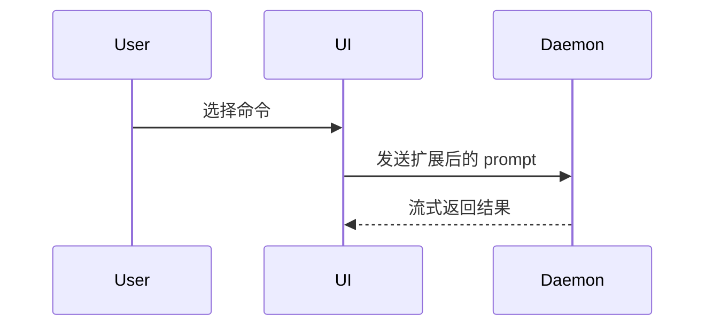

使用此模板编写 PR body：

```markdown
## 摘要

<图表、diff-sketch 或树形结构>

## 证据

- **修改前:** <截图/输出/失败的测试>
  **修改后:** <截图/输出/通过的测试>

## 合并风险

**门类型:** <单向门 或 双向门>

<可选：描述>

**影响范围:** <一词描述>

<可选：合并的潜在影响>
```

## 各部分说明

跳过所有前言，保持简洁。使用用户在 `GLOSSARY.md` 中定义的领域语言。

### 摘要

选择能清晰表达关键点的最小视图。

- **逻辑或算法**使用伪代码：

```text
on(save)
  if content is unchanged
    return cached result
  write new content
  return fresh result
```

- **运行时控制流**使用调用树：

```text
submitForm
  createSession
    persistPrompt
    launchAgent
  navigateToSession
```

- **UI 结构**使用组件树，包括重要的状态和模块边界：

```text
<SessionPage> (apps/example/src/routes/session.tsx)
  useSessionEvents()
  <SessionToolbar>
    <RunSkillButton> (packages/ui)
```

- **文件职责或大范围重构**使用浅层文件树：

```text
src/
├── commands/       # 解析用户操作
├── sessions/       # 管理会话状态
└── transport/      # 发送 API 请求
```

- **组件交互、控制流或数据流**使用 Mermaid：



- **变更点说明**使用 `diff`，当重点是"改了什么"且周围结构已存在时。diff 的形状要匹配主题。

组件变更：

```diff
 <SessionPage>
   useSessionEvents()
   <SessionToolbar>
+    <RunSkillButton />
   <SessionTimeline>
+    <SkillResultCard />
```

文件布局变更：

```diff
 src/
 ├── commands/
+│   └── show-me.ts       # 扩展 slash 命令
 ├── sessions/
-└── transport.ts
+└── transport/
+    ├── client.ts
+    └── stream.ts
```

调用树或调用栈变更：

```diff
 submitForm
   createSession
     persistPrompt
+    expandSkillMention
     launchAgent
-  navigateToSession
+  navigateToSession
+    subscribeToEvents
```

状态或控制流变更：

```diff
 on(save)
-  write content
+  if content is unchanged
+    return cached result
+  write new content
+  invalidate cache
```

- **显示完整代码块**，当大部分是新代码、省略上下文会隐藏所有权或顺序、或用户需要可复制的目标形状时：

```ts
function expandSkill(command: string): string {
  const skillName = command.slice(1);
  return `use the ${skillName} skill`;
}
```

#### 指导原则

将每个可视化内容放在它支持的简短文本旁边。只保留回答用户当前问题或解决当前讨论点所需的调用、文件、属性、状态和边界。

你可以使用其中一种，也可以使用多种，但不太可能全部使用。运用判断力，不要让用户信息过载。

### 证据

变更有效的具体证据。展示修改前后的对比。

**S 级（最佳）**：截图 - 当环境已设置且变更是可视化的时候。

**A 级（优秀）**：基于执行的证据。测试结果、控制台输出。使用伪代码展示现在失败和通过的确切测试。

示例：
```
修改前：
  ✗ should cache unchanged content (失败)

修改后：
  ✓ should cache unchanged content (通过)
  ✓ should invalidate cache on content change (通过)
```

### 合并风险

描述这是单向门还是双向门。双向门可以轻松回退，单向门则不行。容易回滚的 PR 风险较低。涉及破坏性操作或难以逆转决策的变更是单向门。

**影响范围**是此 PR 引入的变更可能产生的潜在影响或范围。考虑所有可能性。示例：布局偏移、消费者的破坏性变更、移动端响应性等。

#### 门类型判断

**双向门（低风险）：**
- 纯新增功能，不影响现有代码
- UI 样式调整
- 新增 API 端点（不修改现有的）
- 可通过 feature flag 控制的功能
- 配置文件的非破坏性更改

**单向门（高风险）：**
- 数据库 schema 变更
- API 破坏性变更（修改/删除现有端点）
- 删除已发布的公共 API
- 身份验证/授权逻辑变更
- 支付/金融逻辑变更
- 不可逆的数据迁移

#### 影响范围示例

- **局部** - 仅影响单个组件或模块
- **中等** - 影响一个子系统或特性
- **广泛** - 跨多个模块或影响核心功能
- **全局** - 影响整个应用或所有用户

## 完整示例

```markdown
## 摘要

添加内容缓存以避免重复写入：

\`\`\`diff
 on(save)
-  write content
+  if content is unchanged
+    return cached result
+  write new content
+  invalidate cache
\`\`\`

## 证据

**修改前：**
- 每次保存都写入磁盘，即使内容未变
- 测试：✗ should avoid unnecessary writes

**修改后：**
- 内容未变时返回缓存结果
- 测试：✓ should avoid unnecessary writes
- 测试：✓ should write when content changes

## 合并风险

**门类型:** 双向门

这是纯优化，不改变外部行为。如有问题可以轻松回滚。

**影响范围:** 局部

仅影响 save 函数的内部逻辑，不影响 API 或其他模块。
```

## 与 WEN 工作流集成

此 skill 应在以下场景使用：
- 运行 `/implement` 或 `/implement-spec` 完成后
- 准备创建 PR 之前
- 代码审查通过后

与其他 skills 的配合：
- 在 `/code-review` 之后使用，确保代码质量
- 结合 `GLOSSARY.md` 中的领域语言
- 遵循 `docs/agents/pr.md` 中的项目规范（如果存在）

## 注意事项

- 保持简洁：用户应该能在 30 秒内理解变更
- 优先使用可视化：一张图胜过千言万语
- 证据必须真实：不要编造测试结果或截图
- 风险评估要诚实：低估风险会导致生产事故
